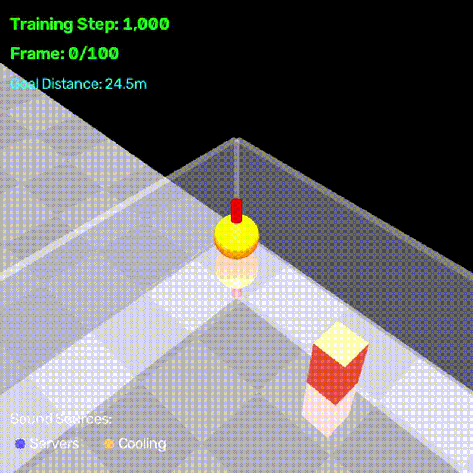

# Physonic: Physics-Driven Acoustic Synthesis for Robot Perception

[](https://www.python.org/downloads/)
[](https://mujoco.org/)
[](LICENSE)

**Physonic** generates realistic acoustic training data for robot perception systems by simulating physics-based contact sounds. It combines MuJoCo rigid-body dynamics with modal synthesis to produce synchronized audio, physics state, and ground truth labels—ideal for training robots to understand their environment through sound.



*Example: PPO agent for data center navigation with acoustic perception*

## Why Physonic?

Modern robots need to perceive their environment through **multiple modalities**. While vision is well-studied, **acoustic perception** remains underexplored due to lack of diverse, labeled training data. Physonic enables **efficient, scalable robot training** through physics-based acoustic synthesis:

### 🎯 Core Capabilities

- **Physically grounded synthesis**: Contact sounds derived from real material properties (compliance, damping, resonant modes)
- **Neural audio compression**: Mimi codec reduces observations by **353×** (44.1kHz stereo → 32×7 codes)
- **Vision-free navigation**: Train robots using audio + ultrasonic sensors only (no camera required)
- **Scalable data generation**: Procedurally generate thousands of scenarios with controlled variation
- **Multi-modal output**: Synchronized audio, physics state, video, and ground truth labels
- **Spatial realism**: HRTF-based binaural audio and room acoustics for commercial environments
- **Hyperscale environments**: Support for 24-2000 rack data centers with optimized physics
- **Robot-ready format**: Export to LeRobotDataset (Parquet) for seamless HuggingFace integration

### 🚀 Why This Matters

**Traditional approach**: Collect thousands of hours of real-world audio → expensive, slow, limited scenarios
**Physonic approach**: Generate infinite labeled training data → fast, cheap, controllable conditions

**Training efficiency**:
- **Before**: 44,100 audio samples per 0.5s window = huge memory footprint
- **After**: 32×7 Mimi codes per 0.5s window = **165× smaller** observations
- **Result**: Train larger models, faster iterations, lower compute costs

### 📋 Use Cases

- **Vision-free navigation** in complex environments (data centers, warehouses)
- **Sound source localization** in 3D space with binaural audio (RL environment included)
- **Material classification** from impact sounds (RL environment included)
- **Selective response** to task-relevant sounds (RL environment included)
- **Acoustic anomaly detection** (identifying equipment failures by sound)
- Event detection (collisions, sliding, rolling)
- Reinforcement learning for contact-rich manipulation
- Multi-modal sensor fusion (audio + ultrasonic + proprioception)

---

## Features

| Feature | Status | Description |
|---------|--------|-------------|
| **Physics Simulation** | ✅ | MuJoCo 5kHz contact dynamics (single + multi-object) |
| **Acoustic Synthesis** | ✅ | Modal synthesis (impact + friction sounds) |
| **Sound Synthesis** | ✅ | Continuous equipment sounds + alert/beep synthesis |
| **Procedural Environments** | 🚧 | Data center template (warehouse, supermarket deferred) |
| **Spatial Audio** | ✅ | HRTF-based binaural rendering (MIT KEMAR) |
| **Acoustic Physics** | ✅ | **Complete theory**: Doppler, air absorption, propagation delay, occlusion |
| **Room Acoustics** | ✅ | Early reflections + late reverb (17 room templates) |
| **Dataset Export** | ✅ | LeRobotDataset format (Parquet + FLAC + MP4) |
| **Video Rendering** | ✅ | Multi-camera RGB + binaural audio (H.264 + AAC) |
| **Photorealistic Rendering** | ✅ | USD export with PBR materials (Isaac Sim, Blender, Omniverse) |
| **RL Environments** | ✅ | Gymnasium integration (3 acoustic perception tasks) |
| **Neural Audio Codec** | ✅ | Mimi compression (353x smaller observations) |
| **Ultrasonic Sensors** | ✅ | 4-way distance sensing for navigation |

---

## Neural Audio Compression (NEW!)

Physonic integrates **Kyutai's Mimi neural audio codec** for efficient RL training with compressed audio observations:

### 🗜️ Mimi Codec Features

- **Compression**: ~353x reduction (44.1kHz stereo → 1.1kbps codes)
- **Frame rate**: 12.5 Hz (vs 44,100 Hz raw audio)
- **Observation size**: 32×7 codes vs 22,050 samples per 0.5s window
- **Quality**: Context-primed chunking maintains spatial audio fidelity
- **Efficiency**: Lazy-loaded, CPU-only, spatial audio culling

### 🤖 Integrated RL Navigation

The data center navigation environment now uses:

**Observations**:
- **Audio codes**: (32, 7) - Mimi-compressed binaural audio
- **Ultrasonic**: (4,) - Front/left/right/back distance sensors (0-5m)
- **State**: (6,) - Position, velocity, heading

**Total features**: 256 + 4 + 6 = **266 features** (vs 44,100 raw audio samples!)

**Key optimizations**:
- Spatial audio culling: Only renders sounds within 30m (reduces 338→30-50 sources)
- HRTF-based binaural rendering for realistic spatial perception
- No vision needed: Robot navigates using audio + ultrasonic only

```bash
# Train with Mimi compression and ultrasonic sensors
PYTHONPATH=. python3 scripts/training/train_ppo_data_center.py \
  --total-timesteps 1000000 \
  --n-envs 4 \
  --learning-rate 3e-4

# Scales to hyperscale data centers (2000 racks!)
PYTHONPATH=. python3 scripts/training/train_ppo_data_center.py \
  --env-scale large_hyperscale \
  --total-timesteps 5000000 \
  --n-envs 8
```

### 📦 Dependencies

Mimi codec requires PyTorch 2.2+ and transformers 4.44-4.45:

```bash
pip install torch==2.2.2 torchaudio==2.2.2
pip install "transformers>=4.44.0,<4.46.0"
```

See `physonic/codecs/README.md` for details.

---

## Audio-Based Navigation (NEW!)

The data center navigation environment now features **true audio-based navigation** with a goal beacon that emits a distinctive sound.

### 🎯 How It Works

**Goal Sound**:
- **1kHz pulsing beep** (2Hz modulation) at goal position
- **Very different** from 120Hz server rack ambient hum
- **Louder** than background (2x volume)
- Robot must **use audio** to locate goal among ~24 sound sources

**Observation Space**:
```python
obs = {
    "audio_codes": (32, 8),    # Mimi-compressed binaural audio
    "ultrasonic": (4,),         # Distance sensors (front/left/right/back)
    "state": (6,),              # Position, velocity, heading
}
```

### 🎮 Reward Shaping Options

**Three modes** (configurable via `reward_shaping` parameter):

| Mode | Description | When to Use |
|------|-------------|-------------|
| **`progress`** (default) | `+10.0 × (prev_dist - curr_dist)` - Positive when moving closer | ✅ **Recommended** - Fast training, good shaping |
| **`distance`** | `-0.01 × distance` - Always negative until goal | Legacy mode, slow training |
| **`sparse`** | No shaping, only terminal rewards | Research, no bias, very slow |

**Terminal Rewards** (all modes):
- Goal reached: **+100.0** (configurable)
- Collision: **-20.0** (4x stronger than before!)
- Out of bounds: **-50.0** (5x stronger than before!)

### 📊 Example Usage

```python
from physonic.envs import DataCenterNavigationEnv

# Default: Progress-based with goal sound (recommended)
env = DataCenterNavigationEnv(
    room_size=(30, 25, 4),
    num_racks=24,
    use_goal_sound=True,      # Enable audio navigation
    reward_shaping="progress", # Progress-based rewards
    goal_bonus=100.0,          # Customize rewards
    collision_penalty=20.0,
    bounds_penalty=50.0,
)

# Sparse rewards (harder, no shaping bias)
env = DataCenterNavigationEnv(
    reward_shaping="sparse",
    use_goal_sound=True,
)

# Legacy distance-based (not recommended)
env = DataCenterNavigationEnv(
    reward_shaping="distance",
    use_goal_sound=True,
)

# Disable goal sound (not recommended - defeats audio navigation!)
env = DataCenterNavigationEnv(
    use_goal_sound=False,  # Robot can't use audio to find goal
)
```

### 🧪 Why This Matters

**Before fixes**:
- ❌ Goal was silent → audio useless for navigation
- ❌ Collision penalty too weak (-5 vs -150 cumulative)
- ❌ No progress feedback → slow learning
- ❌ Robot could ignore audio observations entirely

**After fixes**:
- ✅ Goal emits distinctive 1kHz beep → audio essential
- ✅ Collision penalty significant (6.7% of total reward)
- ✅ Immediate feedback for good actions → fast learning
- ✅ Robot must use audio to navigate efficiently

See `docs/REWARD_ANALYSIS.md` for full technical details and ablation study recommendations.

---

## Acoustic Physics

Physonic implements **complete acoustic propagation theory** for physically accurate spatial audio:

### 🎵 Physical Effects Implemented

1. **Doppler Effect** 🚗
   - Frequency shifts based on relative velocity between source and receiver
   - Formula: `f_observed = f_source × (v_sound - v_receiver) / (v_sound - v_source)`
   - Example: 120Hz server hum → 121Hz when robot approaches at 3 m/s

2. **Air Absorption** 🌫️
   - Frequency-dependent attenuation over distance (ISO 9613-1)
   - High frequencies attenuate faster than low frequencies
   - Example: At 10m, 120Hz fundamental barely affected, 8kHz harmonics -35dB

3. **Propagation Delay** ⏱️
   - Sound travels at finite speed (343 m/s, not instantaneous)
   - Distance-based timing: 10m source = 29ms delay
   - Creates subtle spatial depth cues

4. **Distance Attenuation** 📉
   - Inverse distance law: amplitude ∝ 1/r
   - Volume increases 10× when moving from 10m to 1m
   - Physically accurate energy conservation

5. **HRTF Spatial Filtering** 🎧
   - Head-related transfer functions for binaural perception
   - Left/right ear differences encode azimuth and elevation
   - MIT KEMAR dataset (5° resolution, 128-sample HRIRs)

6. **Occlusion (Optional)** 🧱
   - Low-pass filtering when objects block sound paths
   - Attenuation + high-frequency rolloff
   - Requires line-of-sight calculation

### 📊 Usage

All acoustic physics is automatically applied when generating videos with audio:

```bash
# Train PPO agent with physically accurate audio
PYTHONPATH=. python3 scripts/training/train_ppo_data_center.py \
  --total-timesteps 10000 \
  --n-envs 1 \
  --monitor-training \
  --monitor-freq 2000 \
  --output-dir outputs/my_training

# Videos include complete physics: Doppler + absorption + delay + HRTF
open outputs/my_training/training_videos/*.mp4
```

**Listen with headphones for the full binaural effect!**

### 🔬 What You'll Hear

- **Approaching sound source**: Pitch rises (Doppler), volume increases, sound becomes clearer (less air absorption)
- **Moving away**: Pitch drops, volume decreases, sound becomes muffled (high-frequency absorption)
- **Distant vs near**: Distant sounds arrive later (propagation delay), sound "thinner" (less high-frequency content)
- **Left/right movement**: Smooth stereo position shifts as listener rotates

All effects are **physically grounded** and match real-world acoustic theory.

---

## Photorealistic Rendering (NEW!)

Physonic now supports **USD (Universal Scene Description) export** for photorealistic rendering in professional tools like **NVIDIA Isaac Sim**, **Blender**, and **Omniverse**.

### 🎨 Features

- **PBR Materials**: Physically-based rendering with metallic/roughness workflow
- **Data Center Presets**: Server racks, floors, LED panels with realistic properties
- **Professional Lighting**: Overhead panel grid with cool white illumination (2000 lux)
- **Industry Standard**: USD format compatible with major rendering engines

### 🖼️ Material Presets

| Material | Base Color | Metallic | Roughness | Emissive |
|----------|------------|----------|-----------|----------|
| Server Rack | Dark Gray (0.1, 0.1, 0.12) | 0.8 | 0.3 | None |
| Front Panel | Black (0.05, 0.05, 0.05) | 0.9 | 0.2 | Blue LED (0.0, 0.3, 0.6) |
| Raised Floor | Light Gray (0.85, 0.85, 0.88) | 0.0 | 0.6 | None |
| Robot Body | Orange (1.0, 0.4, 0.0) | 0.7 | 0.4 | None |

### 🚀 Usage

Export any MuJoCo environment to USD format:

```python
from physonic.envs import DataCenterNavigationEnv
from physonic.render.usd_exporter import USDSceneExporter

# Create environment
env = DataCenterNavigationEnv(
    room_size=(30, 25, 4),
    num_racks=24,
    use_mimi=True,
    seed=42,
)

# Export to USD
exporter = USDSceneExporter(
    output_dir="outputs/usd_scenes",
    use_instancing=True,
)

usd_path = exporter.export_scene(
    model=env.model,
    data=env.data,
    scene_name="datacenter_photorealistic",
    camera_position=(20, 15, 8),
    camera_target=(15, 12.5, 0),
)
```

### 🎬 Rendering Options

**1. NVIDIA Isaac Sim** (Real-time RTX):
```bash
# Open Isaac Sim
# File > Open > outputs/usd_scenes/datacenter_photorealistic.usda
# Real-time photorealistic rendering with RTX ray tracing
```

**2. Blender** (Free, offline rendering):
```bash
# Install USD addon
# File > Import > Universal Scene Description (.usd)
# Select Cycles renderer for photorealistic output
```

**3. NVIDIA Omniverse**:
```bash
# Drag USD file into Omniverse viewport
# Automatic PBR material and lighting setup
```

### 📸 What You Get

- **Lighting**: 12-light overhead grid (4×3 layout) with realistic intensity
- **Materials**: PBR shaders with proper metallic/roughness values
- **Camera**: Pre-positioned for optimal viewing angle
- **Geometry**: All MuJoCo bodies exported as USD primitives
- **Scale**: Physically accurate dimensions (1 unit = 1 meter)

### 🎯 Use Cases

- **Marketing materials**: High-quality renders for presentations
- **Visualization**: Understand complex data center layouts
- **Dataset augmentation**: Combine physics simulation with photorealistic rendering
- **Multi-modal training**: Train vision+audio models with realistic visuals

See `test_usd_export.py` for a complete example.

---

## Installation

### Prerequisites
- **Python 3.9+**
- **MuJoCo 3.0+** ([installation guide](https://mujoco.readthedocs.io/en/stable/programming/index.html#getting-started))

### Quick Install
```bash
# Clone repository
git clone https://github.com/ageraustine/physonic.git
cd physonic

# Create virtual environment
python3 -m venv .venv
source .venv/bin/activate  # On Windows: .venv\Scripts\activate

# Install dependencies
pip install -r requirements.txt

# Download HRTF dataset (optional, for spatial audio)
# MIT KEMAR HRTF dataset should be placed in assets/hrtf/test_kemar/
# See: https://sound.media.mit.edu/resources/KEMAR.html
```

### Verify Installation
```bash
# Run quick test
python3 -m physonic.run_demo --out outputs/test --seed 42

# Should generate 8 audio files
ls outputs/test/*.wav
```

---

## Quick Start

All outputs are organized in the `outputs/` directory with subdirectories for different experiment types.

### 1. Generate Single-Object Scenarios (Mono Audio)
```bash
python3 -m physonic.run_demo --out outputs/mono --seed 0
```

**Output**: `outputs/mono/` with 8 scenarios (4 drop + 4 slide) × (steel, glass, wood, rubber surfaces)
- `drop_steel_on_glass.wav` - Sphere dropped from 0.5m
- `slide_wood_on_rubber.wav` - Box sliding at 3 m/s
- `*_telemetry.npz` - Contact forces, positions, velocities (5kHz)
- `*_events.json` - Discrete impact events with times, impulses

### 2. Add Spatial Audio (Binaural)
```bash
python3 -m physonic.run_demo --spatial --hrtf-path assets/hrtf/test_kemar --out outputs/spatial
```

**Output**: `outputs/spatial/` with binaural audio
- Left/right ear signals encode 3D sound source position
- Accurate interaural time difference (ITD) and level difference (ILD)

### 3. Add Room Acoustics
```bash
# Use predefined room template
python3 -m physonic.run_demo --spatial --room warehouse_large --out outputs/reverb

# Or customize room parameters
python3 -m physonic.run_demo --spatial \
  --room-dim 30,20,8 \
  --rt60 2.5 \
  --absorption 0.15 \
  --out outputs/custom
```

**Available room templates**: `warehouse_large`, `data_center`, `supermarket_medium`, `office_small`, `hallway_narrow`, `factory_floor`, `anechoic` ([see all 17 templates](physonic/acoustics/rooms.py))

### 4. Multi-Object Scenarios
```bash
# Available: two_sphere_collision, stack_collapse, sphere_cascade,
#            tumble_box, scatter_pile, domino_chain, rolling_cylinders

python3 -m physonic.run_demo_multi --scenario stack_collapse --spatial --out outputs/multi
```

**Output**: `outputs/multi/` with complex acoustic scenes
- Per-pair contact tracking
- Object-object collision sounds
- Ground truth labels for each object (material, position, velocity)

### 5. Export to LeRobotDataset
```bash
# Export all scenarios from outputs/mono to Parquet dataset
python3 -m physonic.export_dataset \
  --input outputs/mono \
  --output datasets/physonic_v1 \
  --fps 30
```

**Output structure**:
```
outputs/
├── mono/              # Mono audio (8 scenarios)
├── spatial/           # Binaural spatial audio
├── reverb/            # Spatial + room acoustics
├── multi/             # Multi-object scenarios
└── custom/            # Custom experiments

datasets/
└── physonic_v1/
    ├── data/chunk-000.parquet
    ├── audio/binaural/*.flac
    └── meta/info.json
```

**Parquet schema**:
| Column | Type | Description |
|--------|------|-------------|
| `observation.state` | list\[float32\] | Physics state vector (4 or 6N+2 floats) |
| `observation.audio.binaural` | string | Path to FLAC audio chunk |
| `ground_truth.events` | string | JSON list of events in this frame |
| `ground_truth.materials` | string | JSON dict of object materials |
| `ground_truth.sound_sources` | string | JSON list of sound source metadata |
| `episode_index` | int64 | Episode ID |
| `frame_index` | int64 | Frame number within episode |
| `timestamp` | float64 | Time from episode start (seconds) |

---

## Dataset Format Details

### State Vector
**Single-object scenarios** (4 floats):
```python
[z, vz, fn, vt]
# z:  object height (m)
# vz: vertical velocity (m/s)
# fn: normal contact force (N)
# vt: tangential sliding speed (m/s)
```

**Multi-object scenarios** (6N+2 floats for N objects):
```python
[obj1_x, obj1_y, obj1_z, obj1_vx, obj1_vy, obj1_vz,
 obj2_x, obj2_y, obj2_z, obj2_vx, obj2_vy, obj2_vz,
 ...,
 total_fn, total_ft]
# Per object: 3D position + 3D velocity
# Aggregates: total normal force, total tangential force
```

### Audio Chunking
- **Sample rate**: 44.1 kHz
- **Frame rate**: 30 fps (configurable with `--fps`)
- **Samples per frame**: 1470 @ 30 fps
- **Format**: FLAC (lossless compression)

### Timestamp Synchronization
Three timelines are synchronized:
- **Physics**: 5 kHz (0.0002s timestep)
- **Audio**: 44.1 kHz (continuous)
- **Parquet frames**: 30 fps (discrete observations)

Parquet frame times are the source of truth. Audio is chunked into frame-aligned segments, and physics telemetry is downsampled using nearest-neighbor interpolation.

---

## Examples

### Example 1: Material Classification Dataset
Generate 1000 drop sounds across 4 materials with randomized heights:

```python
import numpy as np
from physonic.contact.scene import SceneSpec
from physonic.contact.rig import simulate_scene
from physonic.contact.modal_synth import render_audio

materials = ['steel', 'glass', 'wood', 'rubber']
heights = np.random.uniform(0.3, 1.0, size=1000)

for i, (mat, h) in enumerate(zip(np.random.choice(materials, 1000), heights)):
    spec = SceneSpec(kind='drop', surface='steel', obj=mat, drop_height=h)
    tele, events = simulate_scene(spec)
    audio = render_audio(tele, events, spec)
    # Save audio, tele, events...
```

### Example 2: Sound Source Localization Dataset
Generate binaural audio from random 3D positions:

```python
from physonic.spatial.renderer import render_spatial_scene

azimuths = np.random.uniform(-180, 180, size=500)
elevations = np.random.uniform(-40, 90, size=500)
distances = np.random.uniform(0.5, 3.0, size=500)

for i, (az, el, dist) in enumerate(zip(azimuths, elevations, distances)):
    source_pos = spherical_to_cartesian(az, el, dist)
    binaural_audio = render_spatial_scene(
        spec,
        source_pos=source_pos,
        listener_pos=[0, 0, 1.5],
        hrtf_path='assets/hrtf/test_kemar'
    )
    # Ground truth: az, el, dist
```

### Example 3: Procedural Environment Generation with Sound Synthesis (Phase 3C)
Generate realistic commercial environments with equipment sounds and alert events:

```python
from physonic.environments.data_center import scenario_data_center_maintenance
from physonic.environments.objects import build_scene_with_static_objects
from physonic.synthesis.mixer import mix_acoustic_scene

# Generate data center environment (hot aisle layout)
static_objects, continuous_sounds, alert_sounds = scenario_data_center_maintenance(
    room_size=(20, 15, 3),
    seed=42
)

print(f"Generated {len(static_objects)} objects:")
print(f"  - Server racks: {sum(1 for o in static_objects if 'rack' in o.name)}")
print(f"  - Cooling units: {sum(1 for o in static_objects if 'cooling' in o.name)}")
print(f"  - Equipment sounds: {len(continuous_sounds)}")
print(f"  - Alert events: {len(alert_sounds)}")

# Generate MuJoCo scene XML
xml = build_scene_with_static_objects(static_objects, floor_size=(20, 15))
with open("data_center_scene.xml", "w") as f:
    f.write(xml)

# Mix acoustic scene (equipment sounds + maintenance beep)
acoustic_scene = mix_acoustic_scene(
    impact_sounds=[],  # No impacts in this example
    continuous_sounds=continuous_sounds,
    alert_sounds=alert_sounds,
    duration=5.0,
    continuous_level=0.3,  # Background level
    alert_level=0.6,       # Alert level
)

# Save audio
import soundfile as sf
sf.write("data_center_ambient.wav", acoustic_scene, 44100)
```

**Available environment configurations:**
- **Data center**: 3 layouts (hot_aisle, pod, perimeter) × 3 scenarios (maintenance, failure, normal)
- **Sound synthesis**: Continuous equipment sounds (server_hum, fan, cooling_system, hvac)
- **Alert sounds**: 6 presets (beep, double_beep, alarm, warning, chime, error)

### Example 4: RL Environment for Sound Localization
```python
from physonic.envs import SoundLocalizationEnv

# Create environment
env = SoundLocalizationEnv(
    audio_duration=1.0,              # 1 second audio clips
    use_mel_spectrogram=True,        # Use mel-spectrogram (vs raw audio)
    n_mels=64,                       # Number of mel bands
    material="steel",                # Impact material
    hrtf_path="assets/hrtf/test_kemar/"
)

# Training loop
for episode in range(100):
    obs, info = env.reset()
    print(f"Observation shape: {obs.shape}")  # (64, 87, 2) - mel-spectrogram
    print(f"True azimuth: {info['true_azimuth']:.1f}°")

    # Agent predicts azimuth
    predicted_azimuth = 45.0  # Example prediction
    obs, reward, terminated, truncated, info = env.step([predicted_azimuth])
    print(f"Reward: {reward:.3f}")  # Range: [-1, 0]
    print(f"Angular error: {info['angular_error']:.1f}°")
```

### Example 5: RL Environment for Material Classification
```python
from physonic.envs import SoundClassificationEnv

# Create environment
env = SoundClassificationEnv(
    audio_duration=0.5,               # 0.5s audio for faster testing
    use_mel_spectrogram=True,
    randomize_position=True,          # Vary source distance/azimuth
    hrtf_path="assets/hrtf/test_kemar/"
)

# Training loop with confusion matrix
for episode in range(100):
    obs, info = env.reset()
    print(f"True material: {info['true_material']}")  # steel, glass, wood, or rubber

    # Agent predicts material class (0=steel, 1=glass, 2=wood, 3=rubber)
    predicted_class = env.action_space.sample()
    obs, reward, terminated, truncated, info = env.step(predicted_class)
    print(f"Correct: {info['correct']}, Reward: {reward}")  # 1.0 if correct, 0.0 if wrong

# View confusion matrix
cm = env.get_confusion_matrix()
print("\nConfusion Matrix (rows=true, cols=predicted):")
print(cm)
```

### Example 6: RL Environment for Selective Response
```python
from physonic.envs import SelectiveResponseEnv

# Create environment
env = SelectiveResponseEnv(
    target_materials=["glass"],        # Materials that require response
    audio_duration=0.5,
    target_probability=0.3,            # 30% targets, 70% distractors
    reward_tp=1.0,                     # True positive reward
    reward_tn=0.5,                     # True negative reward
    reward_fp=-1.0,                    # False positive penalty
    reward_fn=-2.0,                    # False negative penalty (worse)
    hrtf_path="assets/hrtf/test_kemar/"
)

# Training loop
for episode in range(100):
    obs, info = env.reset()
    print(f"Is target: {info['is_target']}, Material: {info['material']}")

    # Agent decides: 0=IGNORE, 1=RESPOND
    action = 1 if should_respond else 0
    obs, reward, terminated, truncated, info = env.step(action)
    print(f"Outcome: {info['outcome']}, Reward: {reward}")  # TP, TN, FP, or FN

# Get precision/recall/F1 metrics
metrics = env.get_metrics()
print(f"\nPrecision: {metrics['precision']:.3f}")
print(f"Recall: {metrics['recall']:.3f}")
print(f"F1 Score: {metrics['f1']:.3f}")
```

### Example 6: Loading Dataset in Python
```python
import pandas as pd
import soundfile as sf

# Load Parquet
df = pd.read_parquet('datasets/physonic_v1/data/chunk-000.parquet')

# Access first frame
row = df.iloc[0]
state = row['observation.state']  # [z, vz, fn, vt]
audio_path = row['observation.audio.binaural']  # 'audio/binaural/chunk-00000.flac'

# Load corresponding audio
audio, sr = sf.read(f'datasets/physonic_v1/{audio_path}')
print(f"State: {state}, Audio shape: {audio.shape}, Sample rate: {sr}")
```

### Example 7: Hugging Face Datasets Integration
```python
from datasets import load_dataset

# Load from local directory
dataset = load_dataset('parquet', data_dir='datasets/physonic_v1/data')

# Or push to Hugging Face Hub
dataset.push_to_hub('ageraustine/physonic-warehouse-v1')

# Later, load from Hub
dataset = load_dataset('ageraustine/physonic-warehouse-v1')
```

### Example 8: Interactive RL Environment Demo
Run the interactive demo to test RL environments with random or perfect agents:

```bash
# Test sound localization with perfect agent (ground truth cheating)
python3 scripts/demos/demo_rl_env.py --env localization --agent perfect --episodes 10

# Test material classification with visualization
python3 scripts/demos/demo_rl_env.py --env classification --agent random --episodes 20 --visualize

# Test selective response (glass target detection)
python3 scripts/demos/demo_rl_env.py --env selective --agent perfect --episodes 15 --visualize
```

**Output**: Episode recordings in `outputs/demo_recordings/` with:
- Audio files (.wav)
- Observations (.npy arrays)
- Episode metadata (JSON)
- Visualizations (rewards plot, confusion matrix, episode summary)

**Supported environments**:
- `localization`: Predict azimuth angle from binaural audio
- `classification`: Classify material from impact sound (4 classes)
- `selective`: Binary decision (respond to glass, ignore others)

**Agent types**:
- `random`: Random action selection (baseline)
- `perfect`: Cheats using ground truth (upper bound performance)

### Example 9: Procedural Environment Generation Demo
Generate realistic commercial environments with acoustic signatures:

```bash
# Generate data center maintenance scenario with visualization
python3 scripts/demos/demo_environment_gen.py \
  --env data_center \
  --scenario maintenance \
  --layout hot_aisle \
  --num-racks 8 \
  --visualize \
  --seed 42

# Generate data center equipment failure scenario
python3 scripts/demos/demo_environment_gen.py \
  --env data_center \
  --scenario failure \
  --layout pod \
  --num-racks 12 \
  --visualize
```

**Output**: Environment files in `outputs/demo_environments/` with:
- MuJoCo scene XML (static objects: racks, cooling units)
- Acoustic scene audio (equipment sounds + alerts + events)
- Layout visualization (top-down view PNG)
- JSON summary (object counts, sound specs)

**Available scenarios**:
- `maintenance`: Technician drops tool (impact + beep alert)
- `failure`: Equipment failure (impact + alarm)
- `normal`: Just background equipment sounds

**Layout types**:
- `hot_aisle`: Parallel rows of server racks (cooling optimization)
- `pod`: Clustered rack groups
- `perimeter`: Wall-mounted racks with central open space

### Example 10: 3D Environment Viewer
Visualize generated 3D environments with multi-angle rendering:

```bash
# View existing scene (creates 4-panel view: Front, Top, Side, 3D)
python3 scripts/visualization/view_environment.py --xml outputs/demo_environments/data_center_maintenance_42.xml

# Generate and view on-the-fly
python3 scripts/visualization/view_environment.py --scenario maintenance --layout hot_aisle

# Custom configuration
python3 scripts/visualization/view_environment.py --scenario failure --layout pod --num-racks 12 --seed 99

# Interactive real-time viewer (requires mjpython on macOS, works on Linux)
mjpython scripts/visualization/view_environment.py --xml outputs/demo_environments/data_center_maintenance_42.xml --interactive
```

**Output**: Multi-angle 3D visualization showing:
- Server racks at proper 3D positions (height, width, depth)
- Cooling units placed in room
- Floor plane and room boundaries
- 4 camera angles: Front (0°), Top (bird's eye), Side (90°), 3D (45° perspective)

**Features**:
- Static multi-angle rendering (default on macOS)
- Interactive real-time viewer with mouse controls (Linux or mjpython)
- Automatic camera positioning based on room size
- Saves to PNG file for documentation

### Example 11: PPO Agent Training for Data Center Navigation
Train a PPO agent to navigate complex data centers using acoustic perception:

```bash
# Quick test run (2000 timesteps, 1 environment)
python3 scripts/training/train_ppo_data_center.py \
  --total-timesteps 2000 \
  --n-envs 1 \
  --eval-freq 1000

# Full training (1M timesteps, 4 parallel environments)
python3 scripts/training/train_ppo_data_center.py \
  --total-timesteps 1000000 \
  --n-envs 4 \
  --eval-freq 10000 \
  --save-freq 50000 \
  --output-dir outputs/ppo_datacenter

# Training with video recording (includes complete acoustic physics!)
python3 scripts/training/train_ppo_data_center.py \
  --total-timesteps 10000 \
  --n-envs 1 \
  --monitor-training \
  --monitor-freq 2000 \
  --output-dir outputs/ppo_with_video

# Training with custom hyperparameters
python3 scripts/training/train_ppo_data_center.py \
  --total-timesteps 5000000 \
  --n-envs 8 \
  --learning-rate 0.0001 \
  --n-steps 4096 \
  --batch-size 128 \
  --device cuda

# View training progress with TensorBoard
tensorboard --logdir outputs/ppo_datacenter/logs
```

**Output**: Trained models in `outputs/ppo_datacenter/models/` with:
- `best_model.zip` - Model with highest eval reward
- `ppo_datacenter_XXXX_steps.zip` - Checkpoint every 50k steps
- `ppo_datacenter_final.zip` - Final model after training
- TensorBoard logs for monitoring training curves
- **Training videos** in `training_videos/` (MP4 with binaural audio + complete acoustic physics)

**Environment Details**:
- **Observation**: Dict space with mel-spectrogram (64×50×2) + robot state (6,)
- **Action**: Continuous 2D velocity control (vx, vy) ∈ [-1, 1] m/s
- **Reward**: Distance penalty (-0.01 × distance) + goal bonus (+10) + collision penalty (-5)
- **Episode**: Max 500 steps @ 10Hz (50 seconds), terminates when goal reached or collision
- **Environment**: 30m × 25m data center with 24 server racks, 4 cooling units, 2 moving robots
- **Audio**: Binaural stereo with complete physics (Doppler, air absorption, propagation delay, HRTF)

**Training Results** (2000 timesteps test):
- Mean reward improved: -50.4 → -36.5 (28% improvement)
- Episode length: 500 steps (maxed out, agent hasn't learned to reach goal yet)
- FPS: ~8 on CPU (M1 MacBook Pro)

**Evaluation**:
```bash
# Evaluate trained agent
python3 scripts/training/train_ppo_data_center.py \
  --eval-only \
  --load outputs/ppo_datacenter/models/best_model.zip \
  --n-eval-episodes 20
```

**Watch Training Videos**:
```bash
# Play video with physically accurate audio (use headphones!)
open outputs/ppo_with_video/training_videos/training_rollout_*.mp4

# Check video has both audio and video streams
ffprobe outputs/ppo_with_video/training_videos/training_rollout_00002000_steps.mp4
```

**Layout Variants**:
For training diversity, use different data center layouts:
```python
from scripts.demos.generate_data_center_layouts import generate_data_center_hot_aisle, generate_data_center_pod

# Hot-aisle layout (structured rows)
objs, sounds, grid = generate_data_center_hot_aisle(room_size=(30, 25, 4), num_racks=24, seed=42)

# Pod layout (clustered groups)
objs, sounds, grid = generate_data_center_pod(room_size=(30, 25, 4), num_pods=4, seed=42)
```

### Example 12: Using Enhanced Acoustic Physics Directly
Use the enhanced spatial renderer with complete acoustic physics in your own code:

```python
import numpy as np
from physonic.synthesis.continuous import synthesize_continuous_sound, create_preset_sound
from physonic.spatial.hrtf import load_kemar_hrtf
from physonic.spatial.microphone import BinauralMicrophone
from physonic.spatial.renderer_enhanced import render_spatial_source_enhanced
import soundfile as sf

# Load HRTF dataset
hrtf = load_kemar_hrtf("assets/hrtf/test_kemar/")

# Create sound source (server hum at 5m away)
sound_spec = create_preset_sound(
    source_id="server_1",
    sound_type="server_hum",  # 120Hz fundamental
    position=(5.0, 0.0, 1.0),  # 5m in front
    volume=1.0
)

# Generate mono audio (0.5 second chunk)
mono_audio = synthesize_continuous_sound(
    sound_spec,
    duration=0.5,
    sample_rate=44100
)

# Robot (receiver) position and velocity
receiver_pos = np.array([0.0, 0.0, 1.0])
receiver_velocity = np.array([2.0, 0.0, 0.0])  # Moving toward source at 2 m/s

# Create binaural microphone
microphone = BinauralMicrophone(
    position=receiver_pos,
    orientation=0.0  # Facing forward
)

# Apply complete acoustic physics
binaural_audio = render_spatial_source_enhanced(
    mono_audio,
    source_position=np.array(sound_spec.position),
    microphone=microphone,
    hrtf=hrtf,
    receiver_velocity=receiver_velocity,
    source_velocity=None,  # Stationary source
    apply_doppler=True,     # Frequency shifts
    apply_absorption=True,  # Distance + frequency attenuation
    apply_delay=True,       # Speed of sound (343 m/s)
    occlusion_factor=0.0,   # No occlusion
    sample_rate=44100
)

# Save binaural audio
sf.write("server_hum_with_physics.wav", binaural_audio, 44100)

print(f"Generated binaural audio with complete physics:")
print(f"  - Doppler shift: 120Hz → ~120.7Hz (moving toward source)")
print(f"  - Air absorption: -8dB @ 5m distance")
print(f"  - Propagation delay: ~14.6ms (5m / 343 m/s)")
print(f"  - HRTF filtering: Left/right ear differences for spatial perception")
print(f"\nListen with headphones!")
```

**Physics Applied** (in order):
1. **Doppler**: Frequency increases by ~0.7% (2 m/s approach velocity)
2. **Air absorption**: High frequencies attenuated more than low frequencies
3. **Occlusion**: Optional muffling if objects block path
4. **HRTF filtering**: Binaural spatial cues for direction perception
5. **Propagation delay**: Sound arrives 14.6ms later due to 5m distance

**What you'll hear**:
- Slightly higher pitch than original (Doppler effect from approaching)
- Attenuated sound with high-frequency rolloff (air absorption)
- Spatial positioning in left/right ear (HRTF)
- Subtle delay compared to direct sound (propagation time)

---

## Project Structure

```
physonic_mvp/
├── physonic/              # Core library
│   ├── contact/           # Physics simulation & modal synthesis
│   ├── spatial/           # HRTF binaural rendering
│   ├── acoustics/         # Room acoustics (reverb, reflections)
│   ├── synthesis/         # Sound synthesis (continuous, alerts)
│   ├── environments/      # Procedural environment generation
│   │   ├── layout.py      # Grid-based layout system
│   │   ├── objects.py     # Static object library
│   │   ├── dynamic_scene.py  # Dynamic physics scenes
│   │   └── moving_sound_tracker.py  # Moving sound sources
│   ├── envs/              # Gymnasium RL environments
│   │   ├── sound_localization.py
│   │   ├── sound_classification.py
│   │   ├── selective_response.py
│   │   └── data_center_nav.py  # PPO navigation environment
│   ├── export/            # LeRobotDataset export
│   └── render/            # Video rendering
├── scripts/               # Executable scripts (organized)
│   ├── demos/             # Demo scripts
│   │   ├── demo_environment_gen.py
│   │   ├── demo_rl_env.py
│   │   └── generate_data_center_layouts.py
│   ├── training/          # Training scripts
│   │   ├── train_ppo_data_center.py
│   │   └── train_selective_response.py
│   ├── baselines/         # Baseline agents
│   │   ├── baseline_random.py
│   │   ├── baseline_heuristic.py
│   │   └── baseline_selective_*.py
│   ├── visualization/     # Visualization tools
│   │   └── view_environment.py
│   └── utils/             # Utility scripts
│       ├── setup_hrtf_test.py
│       └── organize_outputs.py
├── tests/                 # Test suite (274 tests)
│   ├── test_contact/
│   ├── test_spatial/
│   ├── test_acoustics/
│   ├── test_envs/
│   ├── test_export/
│   └── test_render/
├── assets/                # Static assets
│   └── hrtf/              # HRTF datasets
├── outputs/               # Generated outputs
│   ├── mono/              # Mono audio scenarios
│   ├── spatial/           # Binaural spatial audio
│   ├── ppo_datacenter/    # PPO training outputs
│   └── demo_*/            # Demo outputs
├── datasets/              # Exported datasets
├── requirements.txt       # Python dependencies
└── README.md              # This file
```

**Important**: All Python files should be in `physonic/` (library code) or `scripts/` (executable scripts). No Python files at project root.

---

## Architecture Overview

```
┌─────────────────────────────────────────────────────────────┐
│                    MuJoCo Physics Engine                    │
│  • Rigid-body dynamics (5 kHz timestep)                     │
│  • Contact force telemetry (normal, tangential, position)   │
│  • Multi-object collision detection                         │
└─────────────────┬───────────────────────────────────────────┘
                  │
                  ▼
┌─────────────────────────────────────────────────────────────┐
│                   Event Extraction                          │
│  • Detect impact onsets from force spikes                   │
│  • Compute impulse (integral of excess force)               │
│  • Filter micro-hops (J/mass < 0.3 m/s threshold)           │
└─────────────────┬───────────────────────────────────────────┘
                  │
                  ▼
┌─────────────────────────────────────────────────────────────┐
│                  Modal Synthesis                            │
│  • Impacts: Decaying sinusoids (resonant modes)             │
│    - Material → frequencies, damping, amplitudes            │
│    - Impulse → mode excitation levels                       │
│  • Friction: Broadband noise + modal ringing                │
│    - Envelope: sqrt(Fn) × sliding_speed                     │
│  Output: Mono audio @ 44.1 kHz                              │
└─────────────────┬───────────────────────────────────────────┘
                  │
                  ▼
┌─────────────────────────────────────────────────────────────┐
│              Room Acoustics (Optional)                      │
│  • Early reflections: Image-source method (order 2-3)       │
│  • Late reverb: Schroeder-Moorer (4 comb + 2 allpass)       │
│  • RT60-based gain tuning                                   │
└─────────────────┬───────────────────────────────────────────┘
                  │
                  ▼
┌─────────────────────────────────────────────────────────────┐
│         Spatial Rendering with Complete Physics            │
│  1. Doppler Effect (frequency shift from velocity)          │
│     • Tracks receiver velocity (robot movement)             │
│     • Applies frequency scaling via resampling              │
│  2. Air Absorption (frequency-dependent attenuation)        │
│     • ISO 9613-1 absorption coefficients                    │
│     • Distance + frequency-based filtering                  │
│  3. Propagation Delay (speed of sound: 343 m/s)            │
│     • Distance-based time shift                             │
│  4. Distance Attenuation (inverse distance law: 1/r)       │
│     • Amplitude scales with distance                        │
│  5. HRTF Binaural Filtering (MIT KEMAR)                    │
│     • 5° resolution, 128-sample impulses                    │
│     • Encodes ITD (±0.65ms) and ILD                         │
│  6. Occlusion (optional, line-of-sight based)              │
│     • Low-pass filter + attenuation                         │
│  Output: Binaural stereo @ 44.1 kHz                         │
└─────────────────┬───────────────────────────────────────────┘
                  │
                  ▼
┌─────────────────────────────────────────────────────────────┐
│                 Dataset Export                              │
│  • Audio chunking (1470 samples/frame @ 30 fps)             │
│  • Telemetry downsampling (5 kHz → 30 fps)                  │
│  • State vector construction                                │
│  • Parquet + FLAC export (LeRobotDataset format)            │
└─────────────────────────────────────────────────────────────┘
```

---

## Material Properties

Physonic includes a database of 4 acoustic materials with validated properties:

| Material | f₀ (Hz) | t₆₀ (s) | Compliance | Use Case |
|----------|---------|---------|------------|----------|
| **Steel** | 800 | 0.8 | Low (0.01) | Rigid, metallic impacts (sharp, ringing) |
| **Glass** | 1200 | 0.5 | Low (0.02) | Brittle, high-frequency (crisp, short decay) |
| **Wood** | 400 | 0.3 | Medium (0.1) | Natural, warm tones (dull thud) |
| **Rubber** | 150 | 0.15 | High (0.5) | Soft, damped (muted, quick decay) |

Each material defines:
- **Fundamental frequency** (f₀) and **mode ratios** (harmonic structure)
- **Decay time** (t₆₀) and **damping slope** (frequency-dependent damping)
- **Compliance** (Hertz contact time → affects impact spectrum shape)

---

## Advanced Usage

### Custom Materials
```python
from physonic.contact.materials import Material

# Define custom material
carbon_fiber = Material(
    name='carbon_fiber',
    density=1600,          # kg/m³
    youngs=150e9,          # Pa
    poissons=0.3,
    compliance=0.015,
    f0=1500,               # Fundamental frequency (Hz)
    mode_ratios=[1.0, 2.7, 5.4, 8.9],  # Harmonic structure
    t60=0.6,               # Decay time (seconds)
    damp_slope=0.0002      # Frequency-dependent damping
)

# Use in scene
spec = SceneSpec(kind='drop', surface='steel', obj=carbon_fiber)
```

### Procedural Scenario Generation
```python
from physonic.contact.scenarios import MultiSceneSpec

# Generate random stack of objects
spec = MultiSceneSpec(
    kind='stack_collapse',
    n_objects=5,
    materials=['steel', 'wood', 'glass'],  # Random selection
    masses=np.random.uniform(0.5, 2.0, size=5),
    sizes=np.random.uniform(0.05, 0.15, size=5),
    initial_height=1.5
)
```

### Batch Export with Custom Preprocessing
```python
from physonic.export.writer import LeRobotWriter
from physonic.export.episode import load_episode

writer = LeRobotWriter(
    output_dir='datasets/physonic_custom',
    fps=60,  # Higher frame rate
    chunk_size=500
)

for episode_dir in episode_dirs:
    episode = load_episode(episode_dir)

    # Custom preprocessing
    episode.audio = apply_noise(episode.audio, snr_db=30)
    episode.audio = apply_eq(episode.audio, freq=200, gain=-3)

    writer.add_episode(episode)

writer.write()
writer.finalize()
```

---

## Testing

```bash
# Run all tests
pytest -v

# Run specific test modules
pytest tests/test_contact/ -v           # Physics & synthesis (19 tests)
pytest tests/test_spatial/ -v           # Spatial audio (44 tests)
pytest tests/test_acoustics/ -v         # Room acoustics (28 tests)
pytest tests/test_export/ -v            # Dataset export (21 tests)
pytest tests/test_render/ -v            # Video rendering (73 tests)
pytest tests/test_envs/ -v              # RL environments (89 tests)

# Run integration tests only
pytest -m integration -v
```

**Test coverage**: 274 tests covering physics simulation, acoustic synthesis, spatial audio, room acoustics, video rendering, dataset export, and RL environments (sound localization, material classification, selective response).

---

## Performance

Benchmarks on MacBook Pro (M1, 16GB RAM):

| Operation | Time | Notes |
|-----------|------|-------|
| Single drop scenario | ~0.8s | 2.5s simulation @ 5kHz |
| Multi-object (5 objects) | ~3.2s | Stack collapse scenario |
| Binaural HRTF convolution | +0.3s | Per scenario |
| Room acoustics | +0.2s | Image-source + reverb |
| Dataset export (100 episodes) | ~45s | @ 30 fps, FLAC compression |

**Scalability**: Parallel generation using `multiprocessing` can process 500+ scenarios in ~10 minutes.

---

## Roadmap

### ✅ Phase 3B: Multi-Camera Video Rendering (Complete)
- [x] MuJoCo offscreen RGB rendering
- [x] Multi-camera support (front, side, top views)
- [x] Tracking camera mode (follows specific object)
- [x] Egocentric camera mode (attached to object)
- [x] MP4 encoding with H.264 codec
- [x] Dataset integration (synchronized video + audio)

### ✅ Phase 4A-4C: RL Environments (Complete)
- [x] Gymnasium integration with audio observation space
- [x] Sound localization task (azimuth prediction)
- [x] Material classification task (4-class discrete action)
- [x] Selective response task (binary respond/ignore decisions)
- [x] Precision/Recall/F1 metrics for evaluation
- [x] Baseline agents and PyTorch training examples

### ✅ Phase 4D: Neural Audio Compression & Sensors (Complete)
- [x] **Mimi codec integration**: 353x compressed audio observations
- [x] **Ultrasonic sensor array**: 4-way distance sensing (front/left/right/back)
- [x] **Spatial audio culling**: Efficient rendering (338→30-50 sources)
- [x] **Data center navigation**: PPO training with Mimi + ultrasonic
- [x] **Scalable to hyperscale**: 24-2000 racks with scene optimization
- [x] **Vision-free navigation**: Audio + ultrasonic only (no camera)

### ✅ Phase 3C: Environment Templates (Partial)
- [x] Data center: dynamic physics objects, moving robots, spatial audio
- [x] Procedural layout generation (hot-aisle, pod layouts)
- [x] Grid-based collision detection and placement
- [x] PPO agent for navigation with acoustic perception
- [x] Hyperscale data centers: 500-2000 racks (China-scale)
- [x] Scene optimization: compound bodies (87.7% body reduction)
- [ ] Warehouse: forklifts, pallets, conveyor belts (deferred)
- [ ] Supermarket: shopping carts, shelving units (deferred)

### Phase 4D: Multi-Modal Fusion
- [ ] Vision + audio observation spaces
- [ ] Sensor dropout and multi-modal robustness
- [ ] Attention mechanism for modality fusion
- [ ] Contact-rich manipulation tasks

### Future Enhancements
- [ ] Mesh-derived modal analysis (replace analytical modes)
- [ ] Perceptual validation studies
- [ ] VBAP/ambisonics for smoother spatial interpolation
- [ ] Real-time synthesis for online RL training
- [ ] USD/Omniverse export for NVIDIA Isaac Sim

---

## Citation

If you use Physonic in your research, please cite:

```bibtex
@software{physonic2025,
  title = {Physonic: Physics-Driven Acoustic Synthesis for Robot Perception},
  author = {Ager Austen},
  year = {2025},
  url = {https://github.com/ageraustine/physonic},
  note = {Version 1.0}
}
```

---

## Contributing

Contributions are welcome! Areas of interest:
- **Materials**: Add more acoustic materials (metals, ceramics, fabrics)
- **Scenarios**: Design new multi-object interactions
- **Validation**: Perceptual studies comparing synthetic vs. real recordings
- **Environments**: Implement procedural scene generation
- **RL Tasks**: Design acoustic perception benchmarks

Please open an issue or pull request on [GitHub](https://github.com/ageraustine/physonic).

---

## License

MIT License - see [LICENSE](LICENSE) for details.

---

## Acknowledgments

- **MuJoCo**: Physics simulation ([mujoco.org](https://mujoco.org))
- **MIT KEMAR**: HRTF dataset ([sound.media.mit.edu](https://sound.media.mit.edu/resources/KEMAR.html))
- **LeRobot**: Dataset format specification ([huggingface.co/lerobot](https://huggingface.co/lerobot))
- **Kyutai Mimi**: Neural audio codec ([huggingface.co/kyutai/mimi](https://huggingface.co/kyutai/mimi))
- Modal synthesis inspired by James et al. (2006) - "Precomputed Acoustic Transfer"

---

## Support

- **Documentation**: See [CLAUDE.md](CLAUDE.md) for detailed architecture and development guide
- **Issues**: [GitHub Issues](https://github.com/ageraustine/physonic/issues)
- **Discussions**: [GitHub Discussions](https://github.com/ageraustine/physonic/discussions)

---

**Built for the robot perception community** 🤖🔊
